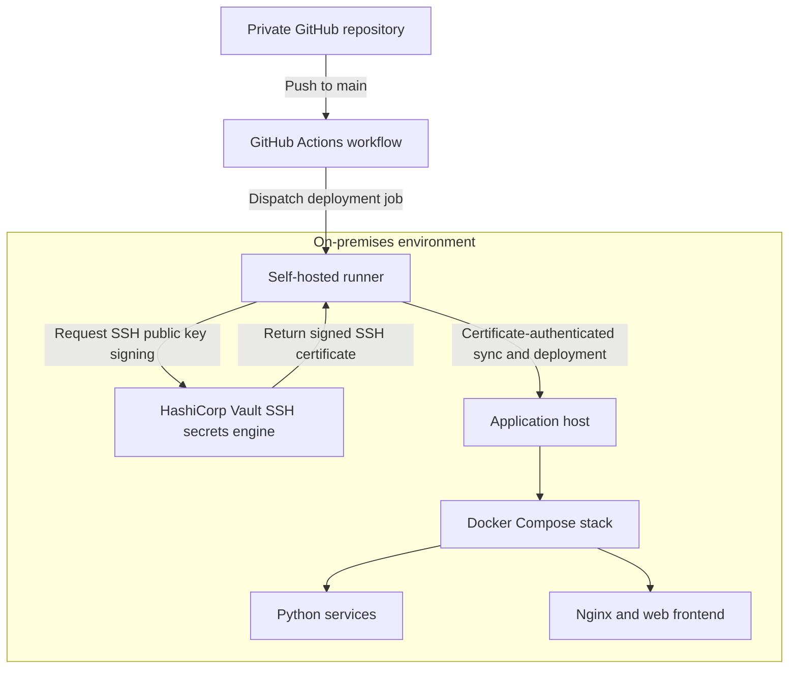

# Architecture

## Public demo runtime architecture

```text
Official alert feeds (optional live profile)
                |
          oref-monitor
                |
         shared runtime/api
          |              |
          |    beready-snapshot-poller
          |              |           |
          |         snapshot    internal mailer (disabled by default)
          |                          |
          |                      optional SMTP
          v
        Nginx <--- static Hebrew/Russian frontend
          |
    localhost preview
```

`oref-monitor` fetches and merges live and historical data, deduplicates alerts and atomically publishes `status`, `history`, `latest_event` and `meta`. `beready-snapshot-poller` reads the shared data and writes `beready_snapshot`; an optional internal SMTP worker receives transition notifications. The experimental scoring engine is not a validated safety system.

Docker Compose starts only the localhost Nginx preview by default. The three Python services require the explicit `live` profile. Geographic data is operator-provided and not distributed. Nginx mounts the API directory read-only and exposes only allowlisted feed names. The SMTP endpoint is never proxied. No production identity, certificate, deployment target or secret is required for preview.

Frontend pages poll JSON endpoints; no WebSocket layer is required. Map layers use Leaflet and optionally MapLibre with an operator-provided MapTiler browser key. OpenStreetMap attribution is retained.

## Original private deployment architecture

The original project was designed as a practical exploration of Vault integration in a CI/CD workflow. The diagram below describes the private deployment design at a logical level; it is not a deployment configuration for this public repository.



### Deployment sequence

1. A push to the private repository's main branch triggers the GitHub Actions deployment workflow.
2. The self-hosted runner checks out the source and generates an SSH key pair for the deployment run.
3. The runner authenticates to Vault and requests signing of the generated SSH public key through the SSH secrets engine. Vault returns an SSH certificate; the private key is not sent to Vault.
4. The runner uses the key and signed certificate to synchronize application files and invoke the remote deployment entry point.
5. The application is hosted on premises as a Docker Compose stack with Nginx serving the frontend and generated API data.

### Security design and publication boundary

- Vault provides centralized SSH certificate issuance for the deployment workflow instead of relying on a pre-distributed static deployment key.
- The runner and application host are part of the private environment. Production runner registration, endpoints, authentication configuration, SSH signing roles, certificate settings and deployment scripts are not distributed here.
- This logical overview is not a claim of a hardened or audited deployment. Host identity verification, credential lifecycle, runner isolation and least-privilege permissions must be reviewed before adapting the design to another environment.
- The public demo is deliberately separate. Its GitLab CI configuration performs source validation only; it does not contact Vault, register a private runner or deploy to the original infrastructure. No successful GitLab pipeline execution is asserted.

