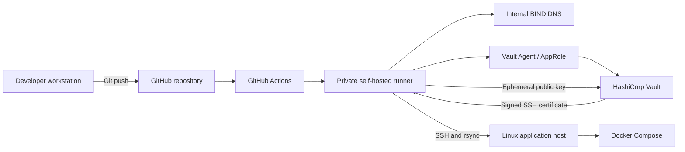
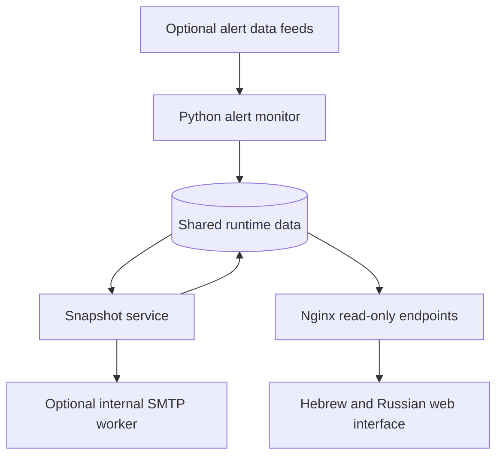

# Architecture

## Original private delivery infrastructure

GitHub Actions orchestrates deployment on a privately hosted runner. Vault Agent performs machine authentication through AppRole; the runner uses the resulting Vault token to request a short-lived certificate for a newly generated SSH key. The runner synchronizes the checked-out repository and invokes a deployment script on the target host. The target does not need to pull the Git repository itself. Docker Compose manages the application services. Application environment configuration remains on the target host; Vault is used for deployment authentication, not as a claim that every application secret is retrieved from Vault.

See [the sanitized workflow example](examples/deploy-vault.example.yml) for a reconstruction of this sequence. It is not an executable production workflow.

## Application services

The monitor merges and deduplicates alert data and publishes JSON records. A separate snapshot service reads the data and produces an experimental BeReady snapshot. An optional internal mail worker handles notifications. Nginx serves the static interface and read-only data endpoints; the mail worker is not publicly proxied. The frontend polls JSON rather than using WebSockets. Map rendering uses Leaflet and optionally MapLibre.

The public Compose definition binds the Nginx preview to loopback; the Python services require the explicit `live` profile. The source files, Nginx configuration, frontend and test files are not yet included in the public repository, so the stack cannot be run as supplied. Geographic datasets and production infrastructure configuration are excluded.

The experimental snapshot is not a validated safety assessment system.
