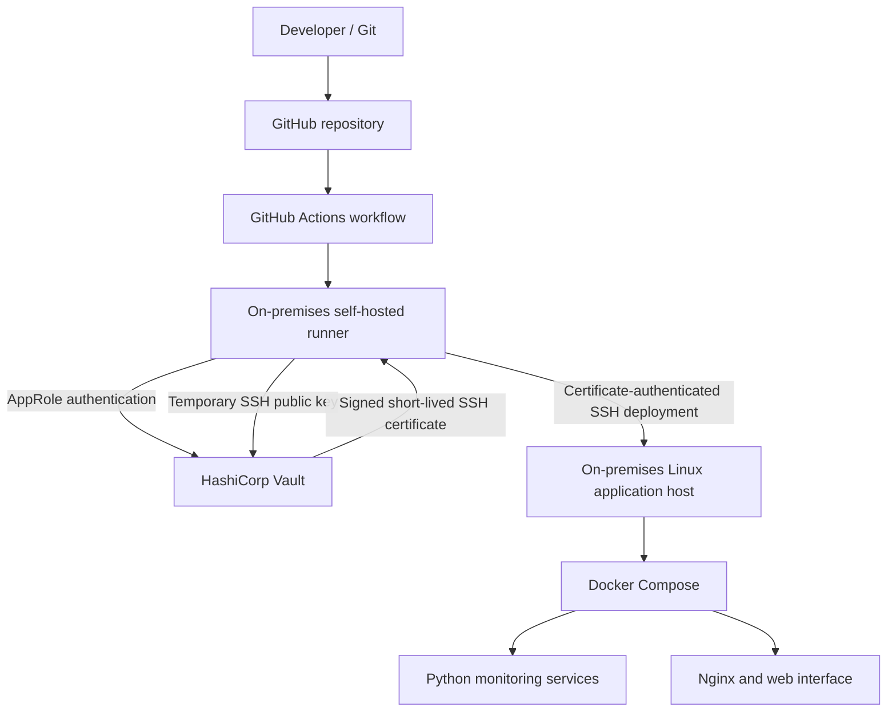
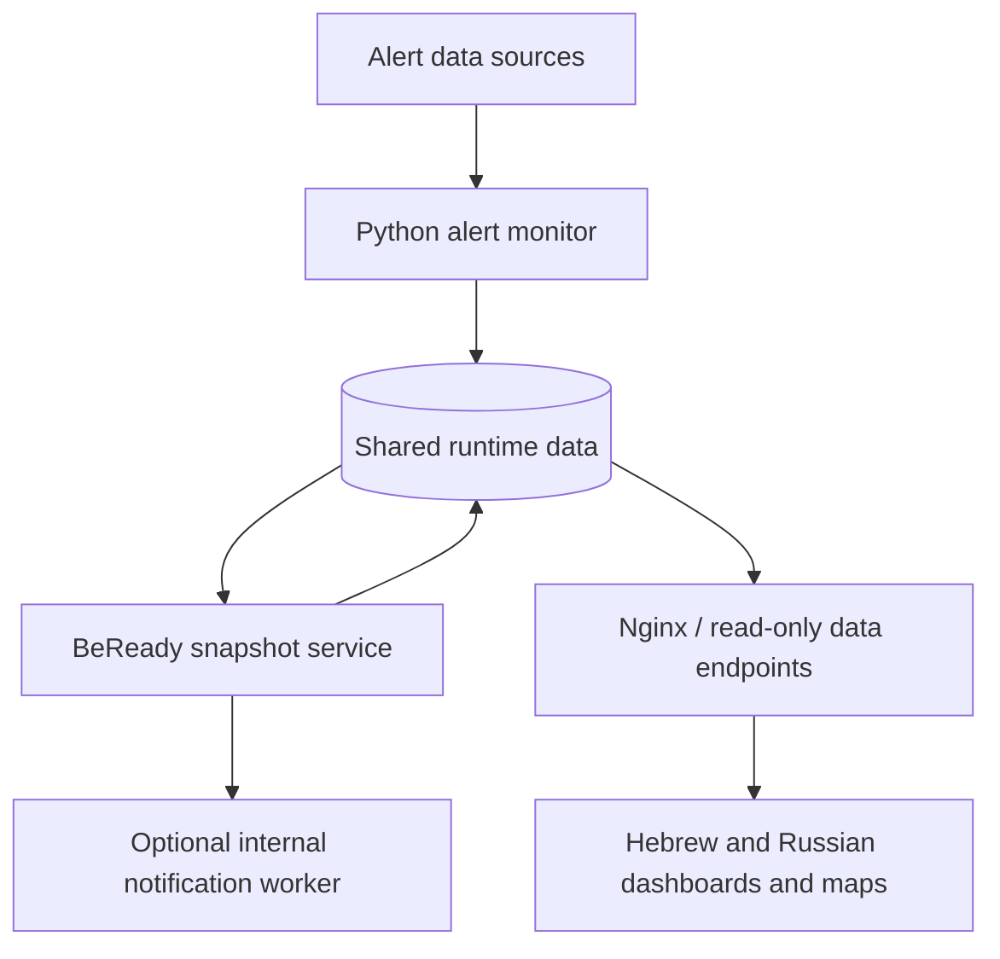

# Lil-RedAlert

**GitHub Actions · HashiCorp Vault · Self-hosted runners · On-premises Docker deployment**

Lil-RedAlert is an independent engineering project that began as a hands-on exploration of HashiCorp Vault in a real-world CI/CD workflow. It evolved into a self-hosted alert-monitoring platform, combining automated deployment, SSH certificate-based authentication, containerized services, and operational monitoring.

The original project was built to deepen my product knowledge and technical support capabilities by implementing and operating the technologies together, rather than evaluating them in isolation.

This repository is a sanitized public portfolio edition. The original private infrastructure and deployment automation are described at a logical level; sensitive configuration and operational data are intentionally excluded.

## 1. Project objectives

- Integrate HashiCorp Vault into an end-to-end delivery workflow.
- Connect GitHub Actions to an on-premises execution environment using a self-hosted runner.
- Use short-lived, Vault-signed SSH certificates for deployment authentication.
- Automate application updates on a Linux host running Docker Compose.
- Develop and operate a practical application with multiple services and a web interface.
- Gain experience troubleshooting the complete system, from CI/CD and authentication to application operation.

## 2. Technology stack

| Area | Technologies |
| --- | --- |
| Source control | Git, GitHub |
| CI/CD | GitHub Actions, self-hosted runner |
| Identity and secrets management | HashiCorp Vault, AppRole, Vault Agent, SSH secrets engine |
| Deployment | SSH certificate authentication, Docker Compose |
| Infrastructure | On-premises Linux, internal DNS (BIND), Docker |
| Web and application services | Nginx, Python, JavaScript, HTML, CSS |
| Mapping | Leaflet, optional MapLibre |

## 3. GitHub Actions & Vault: original private CI/CD architecture

The original environment connects a GitHub-hosted repository to a privately hosted runner and application infrastructure. GitHub Actions orchestrates the delivery job; Vault provides the SSH certificate signing capability used in the deployment flow.

**Explore the implementation:** [Sanitized GitHub Actions deployment workflow (YAML)](examples/deploy-vault.example.yml). This is a reconstruction of the original workflow with placeholder configuration, not a deployed public pipeline.

*Logical view of the original private environment; production configuration is not distributed in this repository.*

### Deployment workflow

1. Application changes are committed to Git and pushed to the GitHub repository.
2. A push to the main branch triggers a GitHub Actions workflow.
3. GitHub Actions assigns the deployment job to a self-hosted runner within the on-premises environment.
4. The runner authenticates to Vault through the configured machine-authentication workflow and generates an SSH key for the deployment run.
5. Vault's SSH secrets engine signs the public key, issuing a short-lived SSH certificate.
6. The runner uses the key and signed certificate to authenticate to the application host over SSH, synchronize application files using rsync, and invoke the private deployment script.
7. Docker Compose manages the application services on the target host.

### Why Vault?

The project explores how a centralized identity and secrets management platform can support automated infrastructure access. In particular, Vault's SSH certificate signing capability allows deployment authentication to rely on time-limited certificates instead of a permanently authorized deployment key.

AppRole and Vault Agent form part of the private machine-authentication setup. The agent provides the token used to request SSH signing. The application retains local environment configuration; Vault is used here for deployment authentication, not for injecting every application secret. Internal DNS supports service discovery within the local environment. The public edition does not contain the original authentication configuration, signing policies, credentials, certificate settings, runner registration, or deployment scripts.

This is an implementation overview, not a claim that the infrastructure has undergone a formal security audit or production hardening review.

### Public GitHub Actions workflow

The public repository includes a separate [validation workflow](.github/workflows/validate-portfolio.yml) for pushes to `main`, pull requests and manual runs. It uses a GitHub-hosted runner to check required files and validate the Docker Compose configuration. It does not build or deploy the application, contact Vault, or use the original self-hosted runner. This workflow is newly prepared for the public portfolio; no successful GitHub Actions run is claimed before it is uploaded and executed.

## 4. Application architecture

The application processes alert data, maintains historical records, and presents information through Hebrew and Russian web interfaces. An additional experimental component, BeReady, computes a separate snapshot from collected data.

| Component | Responsibility |
| --- | --- |
| Alert monitor | Retrieve and normalize data, merge history, eliminate duplicates, and publish JSON records. |
| BeReady snapshot service | Independently process collected data into an experimental snapshot. |
| Notification worker | Optional internal email integration; disabled by default in the public configuration. |
| Nginx | Deliver the web interface and expose selected read-only data endpoints. |
| Docker Compose | Define services, runtime storage, and container connectivity. |

## 5. Public repository scope

The public edition is intended to demonstrate the architecture and engineering decisions without exposing the original environment.

| Included in the current public repository | Kept private or excluded |
| --- | --- |
| Architecture and operational documentation | Original private GitHub Actions deployment workflow |
| Reconstructed deployment YAML and public validation workflow | Actual deployment scripts and settings |
| Sanitized Docker Compose configuration | Vault server configuration, authentication policies and SSH signing roles |
| Example environment configuration | Credentials, tokens, private keys and certificate material |
| Git and Docker ignore rules | Production runner registration and infrastructure identifiers |
| Logical deployment and application diagrams | Private deployment scripts, endpoints and operational data |
| | Geographic datasets with unverified redistribution rights |

The public repository does not connect to the original Vault server, runner, or application host. It is not a complete replica of the private environment.

At the time of this publication, the application source, frontend, Nginx configuration and test directories referenced by Docker Compose and the operations guide are not present in the repository. They must be added as reviewed, sanitized files before the local preview or test commands can be executed successfully. The current repository is therefore an architecture and configuration showcase rather than a runnable release.

## 6. Technical capabilities demonstrated

- Translating a product-learning objective into a practical, end-to-end engineering project.
- Combining CI/CD, machine authentication, secrets management and certificate-based SSH access.
- Integrating cloud-hosted source control with privately hosted infrastructure.
- Designing containerized services and separating data processing from web delivery.
- Operating and troubleshooting an application across infrastructure, deployment and application layers.
- Documenting architecture and operational procedures while separating public material from sensitive implementation details.

## 7. Documentation

- [examples/deploy-vault.example.yml](examples/deploy-vault.example.yml) — reconstructed private GitHub Actions deployment flow.
- [.github/workflows/validate-portfolio.yml](.github/workflows/validate-portfolio.yml) — public configuration-only validation.
- [ARCHITECTURE.md](ARCHITECTURE.md) — application components and data flow.
- [OperationsManual.md](OperationsManual.md) — public validation, private deployment flow and troubleshooting.
- [PUBLICATION.md](PUBLICATION.md) — publication, security review and third-party material considerations.
- [docker-compose.yml](docker-compose.yml) — sanitized application service definitions.
- [.env.example](.env.example) — example environment configuration.

## Disclaimer

Lil-RedAlert is an independent, unofficial technical project, not an emergency warning service. The experimental BeReady component is not a validated safety assessment system. Do not use this repository or its output to make emergency or public safety decisions; follow official instructions instead.

Third-party code, services, map tiles and data remain subject to their respective licenses and terms. This repository does not grant redistribution rights to excluded datasets or third-party material.
